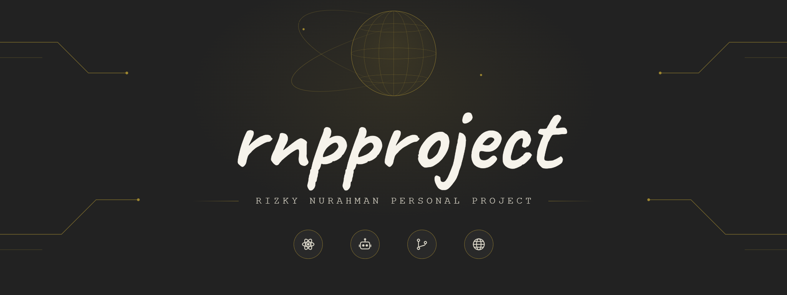

 

## Tentang

**rnpproject** adalah ruang kerja untuk riset, otomasi, dan pengembangan perangkat lunak. Semua proyek di sini dibangun dengan prinsip yang sama: rapi, terdokumentasi, dan mudah dipakai ulang oleh orang lain.

## Fokus

| Bidang | Cakupan |
| --- | --- |
| Riset | Eksperimen dan catatan seputar komputasi kuantum |
| Bot dan otomasi | Bot, skrip, dan alur kerja yang mengurangi pekerjaan berulang |
| Open source | Kode terbuka dengan lisensi yang jelas dan dokumentasi yang memadai |
| Web | Aplikasi web, API, dan layanan pendukungnya |

## Proyek

Daftar ini diperbarui otomatis setiap hari dari repositori publik yang paling baru aktif.

<!-- PROJECTS:START -->
| Proyek | Deskripsi | Bahasa | Bintang |
| --- | --- | --- | ---: |
| [open-vpn](https://github.com/rnpproject/open-vpn) | - | Shell | 1 |
| [profile-contact](https://github.com/rnpproject/profile-contact) | profile contact web | CSS | 0 |
| [test](https://github.com/rnpproject/test) | - | Python | 0 |
| [website](https://github.com/rnpproject/website) | - | HTML | 1 |
| [spam-p](https://github.com/rnpproject/spam-p) | - | Python | 0 |
| [bkn](https://github.com/rnpproject/bkn) | script for vpn tunneling, source from Julak-Bantur | Shell | 0 |
<!-- PROJECTS:END -->

## Statistik

## Berkontribusi

Kontribusi diterima melalui issue dan pull request. Sebelum mengirim perubahan, baca `README` dan `CONTRIBUTING` pada repositori yang bersangkutan, lalu jelaskan masalah atau tujuan perubahannya secara singkat.

## Kontak

- Situs: [rnpproject.com](https://rnpproject)
- Surel: [rizkydn.personal@gmail.com](mailto:rizkydn.personal@gmail.com)
